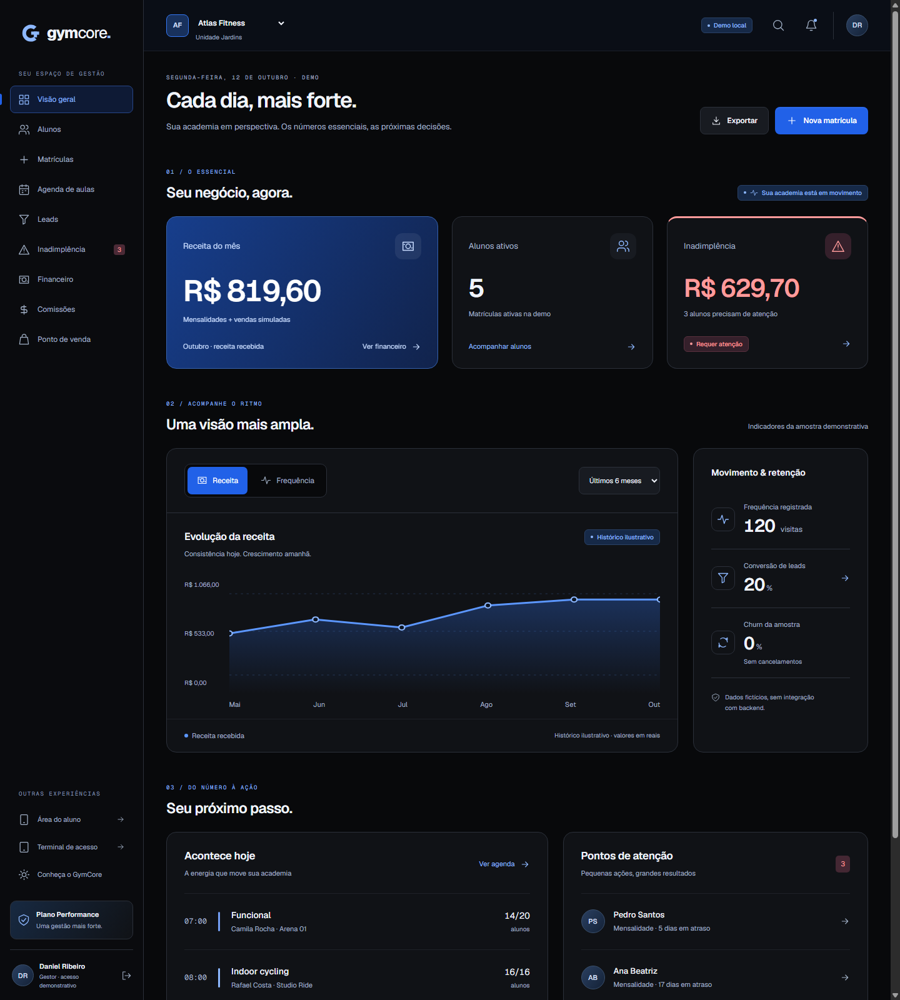

# GymCore

O recorte atual da release administrativa e as flags para módulos adiados estão em [docs/10-release.md](docs/10-release.md). A lista de rotas abaixo descreve a demo completa; módulos adiados retornam 404 por padrão.

Protótipo web funcional de gestão de academias, construído a partir de [prompt.txt](prompt.txt). Tema escuro, identidade própria e três experiências navegáveis. **Não há conexão com backend ou API de negócio.**

## Stack

Next.js 16, React 19, TypeScript e Tailwind CSS 4. Componentes acessíveis com Radix UI, gráficos e ícones próprios em SVG e fontes locais Geist/Geist Mono.

## Executar

Requer Node.js **22.18+** (validado com 24.12) e npm.

```sh
git clone https://github.com/gpego1/gymcore-client.git
cd gymcore-client
npm ci
npm run dev
```

Abra **http://127.0.0.1:3000**. A raiz abre a tela de início com carrossel de fotos de academias. O dashboard fica em `/painel`. Para testar a versão de produção:

```sh
npm run build
npm run start
```

| Rota | Experiência |
| --- | --- |
| /painel | Dashboard e gestão |
| /painel/alunos | Lista, filtros, exportação e perfil |
| /painel/matriculas | Cadastro → plano → contrato → assinatura → cobrança |
| /painel/aulas | Grade de aulas |
| /painel/leads | Kanban de contatos |
| /painel/inadimplencia | Faixas, régua e baixa demonstrativa |
| /painel/financeiro | Fluxo de caixa e exportação |
| /painel/comissoes | Fechamento de professores |
| /painel/pdv | Produtos, carrinho e venda simulada |
| /aluno | Prévia web responsiva do aluno |
| /recepcao | Terminal demonstrativo CPF, QR e facial |
| / e /site | Tela de início com carrossel de academias |
| /login | Entrada demonstrativa, sem autenticação |

## Prévia



Veja também as capturas da [área do aluno](docs/screenshots/aluno.png), [recepção](docs/screenshots/recepcao.png) e [landing page](docs/screenshots/landing.png).

## Explorar os fluxos

- No terminal, **111.111.111-11** representa Mariana ativa; **222.222.222-22** representa o segundo aluno inicialmente em atraso. São identificadores fictícios, sem validação de CPF. Ative o modo offline para ver a indisponibilidade de validação.
- Em aulas do aluno, cycling está lotado: entre na espera e use **Simular vaga e promoção**.
- Em inadimplência, filtre uma faixa e simule a régua; a baixa local libera o acesso do aluno.
- Na matrícula, informe dados fictícios e repita o nome completo na assinatura.
- No cabeçalho da gestão, alterne Atlas/Nord. O estado é separado por academia.

Os mocks persistem no localStorage, chave `gymcore-demo-v2`. Para reiniciar a demo, remova essa chave nas ferramentas do navegador. Fotos selecionadas na evolução ficam somente na memória da tela; não são enviadas nem persistidas.

## Verificações

```sh
npm run typecheck
npm run lint
npm test
npm run test:contrast
npm run build
npm run test:browser
```

A verificação de navegador usa Chrome/Edge Chromium local, sem biblioteca adicional, e inicia uma versão de produção em portas locais livres, escolhidas automaticamente. Execute após o build. Se necessário, defina `BROWSER_PATH`, `QA_PORT` e `QA_BROWSER_PORT`. Ela grava [resultados](docs/browser-qa.json) e capturas em `docs/screenshots/`. Os perfis temporários ficam em `.browser-qa/`, ignorados pelo Git. Não mede FPS ou conformidade WCAG integral.

## Organização

- `src/app/`: rotas Next.js App Router e estilos/tokens CSS.
- `src/components/`: superfícies, gráficos SVG, ícones e primitivas acessíveis.
- `src/lib/domain.ts`: dados fictícios e regras puras de reservas, acesso e indicadores.
- `src/lib/store.tsx`: estado local compartilhado, hidratação e isolamento de academias.
- `public/brand/`: marca vetorial; `public/fonts/`: fontes locais e licença.
- `tests/`, `scripts/`: testes de domínio, navegador e contraste.

## Design e handoff

1. [Conceito criativo](docs/01-conceito.md)
2. [Identidade de marca](docs/02-identidade.md)
3. [Design tokens](docs/03-tokens.md) e [JSON exportável](docs/design-tokens.json)
4. [Motion e catálogo 3D](docs/04-motion.md)
5. [Jornadas críticas](docs/05-jornadas.md)
6. [Telas e layout](docs/06-telas.md)
7. [Componentes e estados](docs/07-componentes.md)
8. [Handoff web e Flutter](docs/08-implementacao.md)
9. [Revisão de qualidade](docs/09-qualidade.md)

## Limites da versão

A experiência do aluno é uma **prévia web**, não um app Flutter. Login, contratos, assinatura, Pix, cobrança, mensagens, QR, reconhecimento facial, catraca, Wellhub e TotalPass são demonstrações. Não existe captura de câmera, processamento de pagamento, envio de mensagem ou autenticação real. A tela inicial usa fotos locais de academias; modelos WebGL e gestos nativos estão documentados como propostas. Não foi feito deploy.
